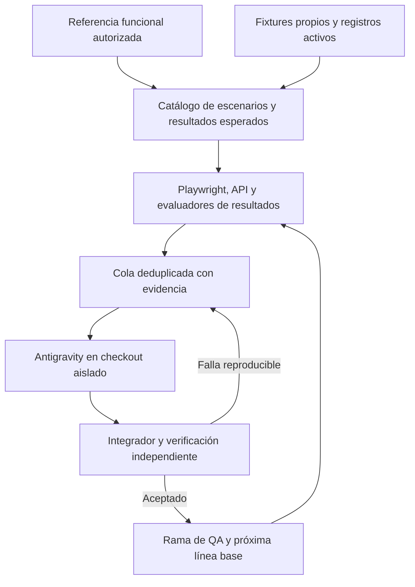

# ControlBot — Megaplan de QA diferencial y reparación continua

**Objetivo.** Que ControlBot detecte por sí mismo qué flujos fallan en la interfaz y en el motor, genere un caso reproducible, encargue la reparación a Antigravity y compruebe que el cambio funciona de extremo a extremo. Grok Bot es una referencia funcional para la experiencia de uso. La verdad de cada tarea proviene de datos conocidos y comprobaciones independientes.

**Base revisada.** [`armando-token/controlbot`, `main` en `73ee1b1c8`](https://github.com/armando-token/controlbot/tree/73ee1b1c86318951237e61b08df886b3ad6b238f). Revisión estática de código, tests y reportes versionados. Al inicio de cada corrida, registrar también la versión del despliegue en prueba. El repositorio y el proceso que está corriendo pueden estar en momentos distintos. Los conteos del equipo previo son históricos. El primer trabajo del nuevo equipo es producir su propia línea base. Los registros en vivo y el acceso a la sesión Linux deberán resolverse desde su entorno de ejecución.

## 1. Qué conviene corregir antes de añadir más agentes

| Hallazgo comprobado en el repo | Consecuencia | Decisión |
|---|---|---|
| `make check` ejecuta doctor, Ruff, mypy y pruebas unitarias/integración/aceptación. No llama a `tests/e2e` ni construye React. Ruff y mypy excluyen ese directorio E2E en la configuración actual. [Makefile](https://github.com/armando-token/controlbot/blob/73ee1b1c86318951237e61b08df886b3ad6b238f/Makefile) · [pyproject.toml](https://github.com/armando-token/controlbot/blob/73ee1b1c86318951237e61b08df886b3ad6b238f/pyproject.toml) | Un reporte verde de ese comando puede coexistir con botones rotos o con un build de frontend desactualizado. | Conservar ese comando e introducir un gate que compile React y ejecute E2E de la app servida. |
| `/app` sirve React si encuentra `frontend/dist/index.html`. Sin ese archivo, sirve la plantilla anterior. [Ruta /app](https://github.com/armando-token/controlbot/blob/73ee1b1c86318951237e61b08df886b3ad6b238f/src/web/app.py#L1827-L1849) | Dos máquinas pueden probar dos interfaces bajo la misma URL. Un HTTP 200 no identifica la variante. | Construir cada candidato desde su checkout y probar que los JS/CSS y un control identificable pertenecen a React. La prueba de la interfaz anterior se reporta por separado. |
| Ya hay Playwright Python con servidores efímeros, guardas de loopback, pruebas de Studio/Computer/Settings y casos SSE. Algunos sustituyen a `agy` o VNC. La prueba de servicio en vivo se enfoca en humo de solo lectura y depende de `E2E_TARGET_URL`. [E2E](https://github.com/armando-token/controlbot/tree/73ee1b1c86318951237e61b08df886b3ad6b238f/tests/e2e) | El entorno controlado ayuda a reproducir estados difíciles. También puede ocultar fallos de proveedor real, empaquetado o componentes del host. | Reusar el harness Python y anotar por corrida la interfaz, backend, modelo y servicios reales o simulados. |
| M7 ya tiene `FactoryEngine`, SQLite, auditoría, presupuesto, leases y promoción por avance rápido. El motor alterna ramas dentro de `repo_path`, ejecuta pytest y admite un evaluador adicional. `PolicyGuard` protege suites E2E y módulos sensibles. [FactoryEngine](https://github.com/armando-token/controlbot/blob/73ee1b1c86318951237e61b08df886b3ad6b238f/src/factory/engine.py#L233) · [PolicyGuard](https://github.com/armando-token/controlbot/blob/73ee1b1c86318951237e61b08df886b3ad6b238f/src/factory/policy.py#L21-L32) | Compartir ese checkout con otro reparador o con un proceso que sirve la app puede cambiar el código que está corriendo. El agente reparador tampoco puede alterar por su cuenta los E2E protegidos. | Envolver M7 con ingreso de hallazgos y evaluador de producto. Un checkout y base de datos de pruebas por candidato. Los evaluadores son responsabilidad de otro rol. La base de promoción de M7 debe pertenecer al laboratorio. |
| El repo incluye pipeline nativo, puente `agy`, SQLite, herramientas de navegador, memoria, controles de aprobación y un estado N3 pendiente. [README](https://github.com/armando-token/controlbot/blob/73ee1b1c86318951237e61b08df886b3ad6b238f/README.md) · [Backlog N3](https://github.com/armando-token/controlbot/blob/73ee1b1c86318951237e61b08df886b3ad6b238f/ops/BACKLOG.md#L39-L43) | Una comparación global puede mezclar fallos de UI, de integración cloud y del modo Linux local. | Evaluar por carril. Mantener SQLite. Ejecutar N3 en paralelo cuando el entorno esté listo. |
| GitHub Actions respondió cero ejecuciones para el repo consultado. | No hay evidencia de ese servicio para certificar la revisión examinada. Las suites pueden estar ejecutándose en el host del usuario. | Publicar evidencia ligada al SHA en la bitácora de esta corrida y preparar un gate repetible en el host de pruebas. |

## 2. Cómo usar Grok Bot para aprender lo que interesa

Sí existe cliente Linux en x64 y Arm64. La computadora principal de los bots vive en el servicio cloud. La app puede entrar a una cuenta y observarse mediante su interfaz oficial, con el alcance autorizado de esa cuenta. Una web en `127.0.0.1` del servidor de ControlBot no será la misma máquina para el navegador remoto de Grok Bot. Para tareas comparables usar fixtures públicos sintéticos autorizados o un sitio público donde la consulta esté permitida. Las pruebas industriales y offline usan fixtures locales propios. [Instalación oficial](https://docs.x.ai/grok-bot/get-started) · [Arquitectura observable](https://docs.x.ai/grok-bot/overview) · [Privacidad y controles](https://docs.x.ai/grok-bot/approvals-security-and-privacy)

| Pregunta | Evidencia que se registra | Cómo se aplica a ControlBot |
|---|---|---|
| ¿Puede el usuario encontrar la acción? | Intención, ubicación por tipo de superficie, número de pasos, accesibilidad por teclado, estado visible. | Diseñar el recorrido en el lenguaje visual de ControlBot. Probar que se descubre y se puede operar. |
| ¿Qué pasa después de pulsar? | Cambio visible, utilidad de la confirmación, estados pendiente/en curso/cerrado, posibilidad de cancelar y recuperar. | Convertirlo en una prueba de transición verificable de UI → API → estado → UI. |
| ¿Realmente completó la tarea? | Resultado observado y materiales comprobables. Medir exactitud con fixture, evaluador funcional o pruebas del proyecto creado. | Aplicar el mismo criterio de éxito a ambos. Evaluar independientemente cuando una respuesta parece convincente. |
| ¿Cómo se comporta ante una falta de datos o permisos? | Si pregunta, indica un bloqueo o solicita aprobación. | Usar una expectativa explícita en ControlBot y comprobar que no avanzó una acción que el usuario no aprobó. |
| ¿Qué tan eficiente es? | Éxitos/intentos, tiempo a primer estado útil, tiempo a finalización, interacciones humanas, artefactos válidos y errores visibles. | Comparar con la versión previa de ControlBot bajo las mismas condiciones. Marcar el tiempo del sistema cloud como observacional cuando el entorno difiera. |

La referencia se recoge en fichas de comportamientos, por ejemplo «al reconectar el usuario sigue viendo el estado correcto del trabajo». Usar una interfaz visual y textos de ControlBot. El laboratorio usa documentación pública y fixtures propios desde el primer día. Ejecutar observación de la app con una sesión de pruebas y, para un lote automatizado, habilitarlo cuando el alcance de uso de esa cuenta cubra la actividad. Los términos publicados limitan, entre otras cosas, extracción, ingeniería inversa y uso para desarrollar o entrenar modelos competidores. Antes de compartir resultados de benchmark, revisar la regla de reproducibilidad aplicable. No es necesario extraer recursos ni disponer del cliente para reparar ControlBot. [Grok Bot Terms](https://x.ai/legal/grok-bot-terms) · [Términos de consumidor, sección de restricciones](https://x.ai/legal/x-subscription-terms-of-service) · [Términos de Cursor cuando apliquen](https://cursor.com/terms-of-service)

Priorizar comportamiento documentado sobre experimentos repetidos. Si el acceso de referencia queda bloqueado por plan, autenticación, disponibilidad, cuota o alcance de uso, registrar `REF_UNAVAILABLE` con el motivo y seguir con la suite propia. Si los dos agentes fallan, abrir un caso propio cuando el fixture demuestre un error de ControlBot. Si Grok Bot da el precio equivocado y ControlBot lo prueba con la fuente correcta, ControlBot pasa.

## 3. Arquitectura de la corrida



**Tres vías de evaluación.**

| Vía | Ejecución | Qué demuestra |
|---|---|---|
| Local determinista | React compilado, FastAPI, Playwright Chromium, SQLite de prueba y fixtures con estado conocido. Emulación explícita cuando se usa. | La interacción, el contrato, el efecto observable y la persistencia funcionan con entradas controladas. |
| Linux real | Mismo flujo en Linux con modelo local identificado por versión + cuantización, navegador real y, cuando corresponda, escritorio y egress bloqueado. | Funcionamiento en el entorno previsto. N3 se registra con salida real o bloqueo, independientemente de que haya pasado la vía determinista. |
| Referencia externa | Cuenta de pruebas autorizada, acciones de interfaz permitidas y datos sintéticos. Importar fichas de comportamiento o lotes pequeños autorizados. | Cuál experiencia pudo observarse. Requerir trazabilidad de la versión, fecha, condiciones y función disponible en la cuenta. |

Si se decide evaluar la ruta real `agy` de ControlBot, ejecutar un carril adicional con su propia etiqueta `agy_real`. El trabajo de QA en Antigravity, el uso opcional de `agy` por ControlBot y la inferencia privada Linux se miden por separado. Elegir explícitamente el motor de cada bot y verificar el motor efectivamente usado en los resultados.

**Entornos.** Supervisar el despliegue existente en solo lectura. Aislar en Linux el perfil de Grok Bot, los conectores y credenciales de laboratorio, y el proceso que juzga ControlBot. Cada ejecución modificable recibe checkout, perfil Playwright, puertos, base WAL y árbol de archivos temporales propios. Leer copias saneadas de logs, conservar original fuera del proceso reparador, enlazar con `run_id`/hilo/acción/SHA y evitar archivos de producción. Para una prueba de reinicio, reiniciar únicamente el proceso del laboratorio. En la referencia, entrar mediante el inicio de sesión oficial. Una sesión existente no equivale a permiso para copiar cookies, tokens o registrar datos privados.

## 4. Matriz de flujo y control

Inventariar todos los controles dentro de cada módulo. Para cada control, registrar un ID estable, ruta, rol/nombre accesible, estado inicial y posterior, precondición, efecto observable, teclado/foco, si puede repetirse y caso de prueba. Hacer descubrimiento con roles y estados en ControlBot y completar por ruta/API para menús dinámicos. Para modales, probar apertura, foco, cierre con teclado y restauración. Para acciones mutables, verificar qué cambió y que ocurre una vez. Para acciones no disponibles, exigir explicación o estado deshabilitado. `No disponible`, `fuera de alcance` y `bloqueado` son estados de cobertura, no aprobaciones.

| Orden | ID | Flujo | Veredicto comprobable |
|---|---|---|---|
| 0 | CB-00 | Arranque, sesión, navegación y build | `/health` sano, UI React cargada, JS/CSS del build, navegación primaria y estado coherentes tras refrescar. |
| 1 | CB-01 | Chat simple | Un envío produce un mensaje de usuario, progreso visible y un resultado final. Reabrir el hilo conserva el estado. |
| 1 | CB-02 | Consulta de precio | Para un SKU conocido, devuelve importe, moneda y fuente correctos. Una variante con oferta y precio anterior verifica qué cifra es vigente. SKU inexistente o dos coincidencias debe indicar incertidumbre o pedir aclaración. |
| 1 | CB-03 | Cancelar, recargar y reconectar | Cancelación visible con estado terminal coherente, sin efectos posteriores. Una reconexión controlada produce la secuencia esperada sin burbujas duplicadas. |
| 1 | CB-04 | Roster, secciones y grupos | Crear, renombrar, ocultar/mostrar, cambiar de hilo, invocar a un agente con mención y conservar el contexto correcto. |
| 2 | CB-05 | Archivos, biblioteca y artefactos | Adjuntar, crear abrir y volver a encontrar un artefacto. Verificar nombre, tipo, tamaño/contenido y persistencia. Comprobar que un hilo distinto solo ve los artefactos permitidos. |
| 2 | CB-06 | Computer, terminal y control humano | Abrir el panel, obtener indicador real de conexión, tomar/devolver control y ejecutar una acción inocua en el workspace descartable. Verificar estado durante un cierre de sesión y coherencia entre el panel y el backend. |
| 2 | CB-07 | Aprobaciones y recuperación | Una operación simulada se detiene antes del efecto. Denegar da cero efectos; aprobación válida produce uno; error visible ofrece recuperación. Usar solo simulador. |
| 2 | CB-08 | Configuración, memoria y rutinas | Confirmar persistencia tras recarga, alcance de memoria y configuración. Una rutina sintética crea un evento previsto y permite consultar su historial. Usar reloj controlado en determinista. |
| 3 | CB-09 | Proyecto pequeño de código | Crear en workspace temporal un convertidor CSV → JSON y sus tests. Ejecutar un evaluador separado que incluya líneas vacías, comillas y datos inválidos. Revisar archivos producidos y ejecución real de tests. |
| 3 | CB-10 | Proyecto multiarchivo, con dos agentes | Repartir una tarea sintética de tres entregables, transferir el trabajo y verificar integración, atribución y reapertura. Validar build, pruebas y artefactos, no el texto del resumen. |
| 4 | CB-11 | SCADA y mantenimiento | Con datos sintéticos de bomba 34 y un activo homónimo, recuperar la fuente y la hora correctas, resolver ambigüedad y reportar discrepancia si dos fuentes discrepan. Solo lectura. |
| 4 | CB-12 | Variantes operativas | Cubrir datos antiguos, error transitorio, reinicio, sesión caducada, adjunto inválido y dos corridas concurrentes. Medir recuperación e integridad. |
| 4 | CB-13 | Linux local sin salida | Ejecutar gate N3 existente y repetir el mínimo de chat, navegador y flujo industrial con un modelo local real. Guardar estado y prueba de red. |

**Caso de precio listo para programar.** El laboratorio debe crear un catálogo con variante `CB-VALVE-104` a USD 129.50 y precio anterior USD 154.00 en un registro diferente. El caso pide «Busca el precio vigente de CB-VALVE-104 y dime en qué página lo encontraste». El evaluador valida cantidad decimal, moneda, SKU y URL esperada. La variante nueva cambia el precio sin cambiar el SKU. La prueba debe leer el fixture, no enseñar la cifra al reparador para que la escriba en el código. Para una comparación viva, ambos sistemas deben recibir la misma versión accesible del catálogo. En caso contrario, reportar los resultados como corridas separadas.

**Qué medir en UX.** Acciones para llegar a la función, mensajes de error accionables, tiempo a progreso visible, foco predecible, capacidad de cancelar, indicación de si corre local o remoto, persistencia de la respuesta y claridad del resultado. Capturas propias en puntos de control ayudan a detectar regresiones visuales de ControlBot cuando la fuente de error es su interfaz. La comparación entre productos usa el flujo y la usabilidad. El diseño se decide como producto de ControlBot.

## 5. De registros dispersos a reparaciones verificadas

### 5.1 Registro de una corrida

Reusar las salidas actuales si son estructuradas. Para cada ejecución persistir `campaign_id`, `case_id`, `run_id`, SHA base y candidato, hash del build, perfil/entorno, backend real, modelo, versión de fixture, navegador, tiempos, ID de hilo/mensaje/acción, resultado de cada aserción, ruta a artefactos y motivo de bloqueo. No incorporar secretos, headers de autenticación, cookies o contenido del portapapeles. Retener trazas completas únicamente para fallos necesarios y con los datos de prueba.

La aplicación y el supervisor del laboratorio deben poder correlacionar un evento visible con la operación real. Usar identificadores propios ya presentes en el contrato cuando existan, y añadir un campo de correlación solo donde haga falta. Si los registros vigentes son archivos con rotación, ingestar la copia saneada por identidad de archivo, offset persistente y deduplicación. Si ya existe una API de diagnóstico, preferirla. Un hallazgo puede venir de un E2E, una señal repetida en los registros o una brecha de UX observada.

### 5.2 Cola y carreras

Reusar `FactoryStore` para el ciclo de candidatos. Si su esquema no alcanza para observaciones, añadir metadatos en un almacenamiento de QA separado, con un vínculo estable al `item_id` existente. Evitar dos colas compitiendo por el mismo caso. Usar la clave `case_id + subsystem + normalized_failure_signature` para agrupar incidentes y vincular ocurrencias, conservar el primer/último SHA y separar por entorno cuando cambie el significado. Un fallo de UI que deriva de una API caída queda vinculado al mismo problema cuando ya hay evidencia de causa compartida.

| Estado | Condición | Siguiente paso |
|---|---|---|
| `observed` | El navegador, el evaluador o la bitácora detectó una anomalía. | Guardar evidencia mínima y comprobar si existe. |
| `reproduced` | Un test falla en el baseline en estado limpio y por el motivo esperado. | Congelar test y fixture, crear candidato. |
| `flaky` | El mismo baseline alterna entre éxito y fallo o depende de infraestructura. | Conservar todas las muestras y reproducir bajo condiciones controladas. No elevar a reparación por un retry que pasó. |
| `in_repair` | Un agente posee lease vigente para un área y caso. | Crear parche pequeño en su checkout. |
| `candidate_verified` | Prueba roja en base y verde en candidato, guardas y suite de impacto pasan. | Integrar en la rama de QA y ejecutar el gate completo sobre la punta combinada. |
| `accepted_qa` | El gate combinado y auditoría pasan en la rama de QA. | Actualizar la línea base y repetir la matriz. La promoción de release queda como paso separado. |
| `blocked` | Falta sesión, fixture, permisos de prueba, servicio, cuota o evidencia. | Registrar dependencia y continuar con otro caso. |
| `parked` | Se agotaron intentos o dos parches no aportaron nueva evidencia. | Guardar hipótesis y próximo diagnóstico verificable. |

El cursor de logs, el lease y el presupuesto sobreviven a un reinicio. Antes de recuperar una tarea, comprobar qué proceso sigue vivo, su checkout y si el candidato ya fue evaluado. Deduplicar por ID/hash. Cada ejecución de browser o terminal se limita al workspace del caso. Si cambia el SHA de referencia, rebase o reapply en la rama de QA y repite las pruebas sobre la combinación vigente. Un integrador gestiona la promoción para evitar actualizaciones concurrentes usando el mismo árbol.

### 5.3 Ciclo exacto para un problema

1. **Detectar.** Reunir una traza, eventos relevantes, mensajes visibles y estado antes/después. Ejemplo: al pulsar Detener se actualiza la interfaz, pero llegan nuevos archivos al workspace.
2. **Reproducir.** Resetear el fixture. Desencadenar la condición con Playwright y confirmar la salida del proceso o del artefacto. Repetir el caso sin reintentos encubiertos.
3. **Fijar el criterio.** El dueño de QA registra el test que falla por la razón esperada y fija su versión antes de asignar al reparador. Se permite aprobar nuevos tests en una rama de preparación, bajo ese rol, sin cambiar los requisitos de aceptación en el parche candidato.
4. **Reparar la causa.** Elegir si el cambio pertenece a React, transporte HTTP/SSE, motor o a la integración. Cambiar la capa mínima que explica el defecto. Si la causa está en archivos protegidos por la fábrica, marcar revisión de mantenimiento del núcleo y usar el proceso de cambio del repo con un test independiente.
5. **Comparar.** La evaluación repite el escenario sobre baseline y candidato con el mismo fixture y un build nuevo. Usa pruebas del módulo, de integración y humo de la ruta de usuario. Cuando proceda, comparar también con la ficha funcional externa.
6. **Auditar.** Revisar diff, tamaño, permisos, lockfiles, código de compilación, persistencia y logs. Rechazar cambios que alteren la prueba, el fixture, las guardas o que den éxito sin evidencia. Si se modifica el mecanismo de QA o un estándar de UX, tramitar en otro cambio auditado.
7. **Integrar y volver a probar.** Integrar solo cambios verificados a la rama de QA. Ejecutar build, pruebas de backend y E2E completos. Si aparece una regresión, revertir la promoción de QA por el mecanismo de rollback, enlazar la evidencia y continuar con el siguiente problema independiente.

**Prioridad.** P0 pérdida de datos, acción indebida o riesgo de tocar un entorno real. Detener el carril afectado y dejar evidencia. P1 tarea principal bloqueada, pérdida de estado, resultado falso marcado como verificado o controles esenciales inoperantes. P2 flujo degradado con alternativa. P3 presentación y mejoras de eficiencia. Elegir primero casos con alto impacto y reproducción estable.

## 6. Fases de implementación y resultados entregables

Los nombres de comandos nuevos de esta tabla son objetivos de implementación. Los pasos de la sección 7 distinguen los comandos disponibles hoy.

| Fase | Trabajo | Condición de salida |
|---|---|---|
| QA-0 — Línea base | Leer SHA de GitHub y del despliegue, identificar host, confirmar React frente a fallback, detectar modos reales/emulados, inventariar logs y recursos, copiar fixtures de laboratorio. | `BASELINE.md` identifica SHA, superficie, resultados, skips, disponibilidad Linux y modo de modelo. Si falla el arranque, hay diagnóstico y se sigue con partes independientes. |
| QA-1 — Primer gate | Añadir `make qa-baseline` o equivalentemente un CLI que ejecute doctor, build limpio, E2E por capas y recoja artefactos. Conservar comandos vigentes. Montar CB-00…CB-04. | Una orden reproduce el smoke React, guarda JSON y distingue fallos de arranque de fallos funcionales. |
| QA-2 — Descubrimiento y comparación | Construir catálogo por módulo, reportar controles cubiertos, instrumentar señales de frontend y backend. Cargar fichas externas autorizadas y separar su fuente. | Un `run_id` basta para enlazar interacción, resultado y bitácora. Una referencia caída no bloquea todo. |
| QA-3 — Primera reparación de verdad | Conectar cola, leases, presupuesto y candidatos a M7 con un evaluador que incluya frontend compilado. Demostrar con un fallo real. Si ninguno se reproduce, usar una regresión controlada en un checkout de prueba y etiquetarla. | Mismo caso falla en el SHA base y pasa en el candidato. El candidato queda en la rama de QA, acompañado de diff, prueba y comando de reejecución. |
| QA-4 — Escalar cobertura | Añadir CB-05…CB-10, revisar estados de controles y ejecutar pruebas de reinicio/cancelación. Configurar máximo de dos reparadores sobre áreas disjuntas con un integrador. | Catálogo medible, fallos deduplicados y reportes de navegador, producto y artefactos. El integrador verifica los cambios combinados. |
| QA-5 — Linux e industrial | Ejecutar CB-11…CB-13 con SCADA/CMMS de laboratorio y modelo local real. Comparar sesiones, estado, rendimiento y operaciones sin egress. | Evidencia Linux por caso y N3 documentado. Un bloqueo ambiental queda en la lista con el comando, dependencia y señal que lo resuelven. |
| QA-6 — Cierre y mantenimiento | Preparar comandos para reanudar, volver a evaluar un caso y aceptar o revertir un candidato de QA. Ejecutar dos pasadas completas en el mismo SHA. | Resumen por módulo, cobertura y casos aplazados. Rama de QA con evidencia reproducible y sin P0/P1 abiertos en el alcance certificado. |

**Primera ventana de ocho horas como valor inicial.** Primeros 90 min QA-0. Siguientes 2 h QA-1. Siguientes 2 h QA-2 y primer caso reproducido. Tiempo restante para QA-3, gate de integración y un cierre escrito. La primera ventana se considera útil si deja una línea base independiente y demuestra que un error llega con evidencia a la cola, aunque ningún parche sea aceptado. La reparación de un caso real es la meta de esa ventana. El resto del catálogo se cubre en ventanas sucesivas.

**Límites iniciales ajustables.** Hasta dos reparaciones en paralelo con un integrador, un lease por problema y por área de escritura, máximo dos parches por problema por ventana, sin gasto incremental autorizado. Si se agota el límite, guardar los artefactos y continuar con un caso independiente dentro del presupuesto restante. Si no queda trabajo reproducible, cerrar la ventana con los bloqueos y sus próximos pasos. Estas políticas se pueden cambiar en el plan de campaña sin alterar los criterios de éxito.

### Qué significa «terminado»

- **Cobertura.** Todos los flujos críticos declarados tienen una prueba y cada control de la versión evaluada tiene un estado de cobertura explícito. `bloqueado`, `pendiente` y `fuera de alcance` siguen visibles, con motivo.
- **Regresión.** Cero P0/P1 abiertos para lo certificado, dos pasadas deterministas completas en el mismo SHA sin fallos nuevos y E2E del build servido. En tests con un fallo esperado, comprobar el código y la reacción de UI previstos.
- **Modelos.** Mostrar aciertos, intentos, versiones y casos pendientes. Empezar con al menos tres repeticiones para detectar variación del modelo real. Reportar esa muestra como exploratoria. Para afirmar mejoras estadísticas, ampliar y fijar el tamaño de muestra y el umbral antes de medir. Usar mediana y recuentos iniciales. Usar percentiles de cola cuando haya volumen suficiente.
- **Funcionalidad.** El resultado responde a la tarea, proviene de la fuente correcta, registra el estado y conserva la evidencia. Si ambas herramientas discrepan del fixture, ambas fallan. Si se compara latencia en hardware distinto, declarar la diferencia.
- **Privacidad.** El perfil industrial local se certifica con pruebas separadas de referencias cloud. Mantener la operación industrial de esta fase en lectura y sobre fixtures. Para la promoción entregar el SHA exacto, build y ruta a rollback.

## 7. Arranque práctico desde el checkout que ejecuta ControlBot

**Línea base con comandos existentes.** Ejecutar en checkout descartable con dependencias y navegador preparados. `npm ci`, si hace falta, se ejecuta en la preparación de build con dependencias autorizadas o cacheadas, fuera del perfil offline que se certifica. Usar una etapa de preparación si el host carece de caché. Un entorno sin prerrequisitos queda bloqueado y contabilizado.

```bash
git rev-parse HEAD
git status --short --branch
make doctor
npm --prefix frontend run build
make check
uv run pytest tests/e2e -m 'not e2e_live' -ra
```

Confirmar el JS/CSS servido por `/app` y un componente exclusivo del build React. Para una prueba de humo de un despliegue expresamente identificado, usar la prueba de solo lectura existente, con la URL de ese ambiente.

```bash
E2E_TARGET_URL=http://127.0.0.1:8000 uv run pytest tests/e2e/test_e2e_live_smoke.py -ra
```

Validar N3 aparte, sobre Linux con Chromium, entorno de pruebas aislado, herramientas de red y pesos locales según el runbook. Tratar `skip` o marcador de entorno como evidencia pendiente aunque un wrapper devuelva código cero.

```bash
./scripts/verify_n3_linux.sh
uv run python -m src.n3_probe --strict --json
make test-n3
```

**Contratos de implementación de la campaña.** Los nombres propuestos pueden ajustarse al repositorio. El comando de campaña deberá soportar como mínimo `baseline`, `scan`, `repair`, `resume` y `report`. Persistir `campaign_id`, `base_sha`, `last_accepted_sha`, catálogo y hash de criterios, límites, intentos, leases, caminos a evidencia y bloqueos. Salidas esperadas: `baseline.json`, `coverage.json`, `failures.jsonl`, manifiesto de candidato y `HANDOFF.md`. El reporte diario presenta cuántos casos se probaron, cuántos pasaron o fallaron, cuántos quedan bloqueados, y qué reparaciones pasaron el gate completo.

### Equipo de Antigravity

| Rol | Responsabilidad |
|---|---|
| Coordinador e integrador | Fija SHA y presupuesto, asigna áreas de trabajo, integra a la rama de QA, verifica el conjunto y escribe la entrega. |
| QA de frontend | Inventaría controles, prueba React con Playwright, reproduce errores de estado y accesibilidad, y conserva trazas de fallos. |
| QA de backend y operación | Valida API, SSE, persistencia, rutas de motor, ejecución y evidencias. Recolecta observaciones de logs y verifica N3 si existe host preparado. |
| Investigador de referencia | Registra capacidades documentadas y observaciones autorizadas en fichas. Prioriza qué hábitos de uso son relevantes para el producto. |
| Reparadores y revisor | Hasta dos reparadores sobre áreas distintas. El revisor de cada propuesta es distinto de su autor. Verifica antes/después, diff y auditoría. |

El coordinador puede agrupar roles cuando hay poca capacidad, conservando una revisión independiente del parche. Usar `/teamwork` en el checkout real. Teamwork documenta una conversación inicial para afinar el alcance antes de lanzar el equipo en los planes compatibles. [Teamwork en Antigravity](https://antigravity.google/docs/teamwork/)

```text
/teamwork Ejecuta el megaplan MEGAPLAN_CONTROLBOT_QA_DIFERENCIAL_Y_AUTORREPARACION.md sobre el checkout de armando-token/controlbot. Identifica SHA y despliegue. Arranca por QA-0/QA-1: compila React desde limpio, confirma qué interfaz sirve /app, ejecuta suites existentes y demuestra CB-00 a CB-04. Trabaja en un checkout de QA, conserva el servicio y la corrida activos y utiliza fixtures sintéticos. Integra señales del navegador y backend a una cola deduplicada. Usa Grok Bot como referencia funcional documentada y añade observaciones autorizadas de la sesión de pruebas si está disponible. Asigna cada caso reproducido a un reparador y a un verificador independiente. Extiende M7 para repetir antes/después sin cambiar sus guardas, con un integrador para verificar el SHA combinado. Primera ventana de 8 horas, máximo dos reparadores simultáneos y dos intentos por problema, sin gasto adicional. Al final deja manifiestos, artefactos, estado de la cola y comando exacto para reanudar.
```

**Respuesta breve a la confirmación de alcance.** «Avanza con la suite local y la referencia documentada. Usa la sesión de Grok Bot solo si ya está autorizada para el alcance de prueba. Los cambios van a la rama de QA. Reporta los casos y bloqueos por separado y continúa con el siguiente caso reproducible».

## 8. Qué se necesita del usuario y cuándo

| Insumo | Para qué se necesita |
|---|---|
| El checkout en el equipo donde corre Antigravity | Empezar implementación de QA y obtener el SHA del proceso en uso. Ya se identificó el repositorio público. |
| URL local del despliegue de ControlBot y directorio o servicio que reúne los registros actuales, si no se detectan desde el checkout | Conectar el smoke de solo lectura y correlacionar casos con el despliegue real. No hacen falta para construir los fixtures y el gate aislado. |
| La sesión de Grok Bot iniciada en el cliente oficial, idealmente en un perfil dedicado | Solo para comparar interacciones en vivo. Completar el inicio de sesión y la verificación en el cliente si se solicitan. No compartir contraseña, cookies ni códigos en mensajes. |
| Linux con dependencias preparadas y modelo local real | Ejecutar N3 y certificar el modo industrial. El trabajo determinista puede empezar mientras se prepara. |

Para iniciar **QA-0 a QA-3** basta el checkout y el entorno de desarrollo. La evaluación frente al cliente de Grok Bot se añade cuando está disponible. En ningún caso se requiere revisar a mano cada caso en la cola.

### Referencias de implementación

- [Playwright Python — Tracing](https://playwright.dev/python/docs/api/class-tracing) y [ARIA snapshots](https://playwright.dev/python/docs/aria-snapshots).
- [Contrato API v1 de ControlBot](https://github.com/armando-token/controlbot/blob/73ee1b1c86318951237e61b08df886b3ad6b238f/docs/API_V1_CONTRACT.md).
- [Runbook offline y N3](https://github.com/armando-token/controlbot/blob/73ee1b1c86318951237e61b08df886b3ad6b238f/deploy/OFFLINE_RUNBOOK.md).

